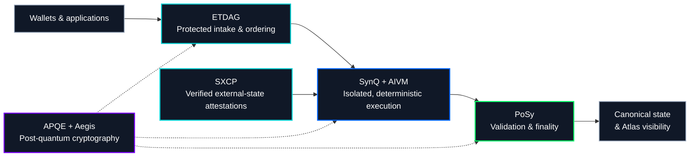

<!--
  Synergy Network | Official GitHub organization profile
  Repository: https://github.com/synergy-network-hq/.github
  Publish at: profile/README.md
-->

<div align="center">
  <a href="https://synergy-network.io">
    
  </a>

  <h1>Synergy Network</h1>
  <h3>Secure by Design.</h3>

  <p><strong>A post-quantum-first Layer-1 engineered for verifiable execution, resilient consensus, and connected digital ecosystems.</strong></p>
  <p>Purpose-built blockchain infrastructure. Hybrid DAG architecture. Security at the protocol layer—not as an afterthought.</p>

  <p>
    <a href="https://synergy-network.io"><strong>Website</strong></a> ·
    <a href="https://synergy-network.io/whitepaper"><strong>Whitepaper</strong></a> ·
    <a href="https://forge.synergy-network.io"><strong>Developer Hub</strong></a> ·
    <a href="https://synqlang.dev"><strong>SynQ</strong></a> ·
    <a href="https://synergy-network.io/community"><strong>Community</strong></a>
  </p>

  <p>
    
    
    
    
  </p>
</div>

---

## A different foundation for decentralized technology

Blockchains should not require users to choose between security, performance, interoperability, and control. Yet many existing systems inherit foundational compromises: cryptography that must eventually be replaced, transparent transaction queues that expose user intent, broad execution trust boundaries, and cross-chain mechanisms that introduce new custody risks.

**Synergy Network is being engineered to address those constraints at the architectural level.** It combines a native Layer-1 protocol, a hybrid blockchain/DAG design, cooperative validator consensus, post-quantum cryptographic integration, protected transaction ordering, and compartmentalized execution.

Our goal is not simply to move transactions between accounts. It is to establish a secure, extensible foundation for digital assets, applications, identities, and cross-network coordination.

> **The principle is simple: the security model should shape the architecture—not be bolted on after deployment.**

## Four pillars. One architecture.

| Pillar | Responsibility | What it brings to the network |
| :--- | :--- | :--- |
| **SynQ** · Logic | Smart contracts and deterministic computation | A purpose-built smart-contract language designed for explicit authority, predictable state transitions, and verification-oriented development through AIVM. |
| **SXCP** · Connection | Cross-chain interoperability | Deterministic, verifiable attestations designed to coordinate with external networks without relying on conventional pooled-custody bridges. |
| **PoSy** · Consensus | Validation and finality | **Proof-of-Synergy**, a cooperative consensus architecture designed around validator coordination, resilient participation, and deterministic finality. |
| **Aegis** · Security | Post-quantum cryptography | Cryptographic primitives integrated through Synergy's **Aegis Post-Quantum Cryptography Engine (APQE)**, establishing security services as part of the protocol architecture. |

These are not four disconnected product features. They are interdependent parts of a single security and execution model.

## Security that extends beyond signatures

Post-quantum signatures matter, but protecting a network requires more than replacing one cryptographic algorithm. The Synergy design addresses how transactions enter the network, how authority is established, how execution is isolated, and how state is verified.

| Capability | Architectural approach |
| :--- | :--- |
| **Post-quantum cryptography** | APQE integrates Aegis-PQC cryptographic capabilities, with protocol-defined algorithm profiles, key lifecycle management, and cryptographic agility. The architecture incorporates standards-based families such as ML-DSA and ML-KEM. |
| **ETDAG protected ordering** | Encrypted transaction submission, availability and ordering agreement, threshold reveal, and subsequent execution—designed to reduce exploitable early disclosure and common transaction-ordering attacks. |
| **AIVM compartmentalized execution** | The **AIVM execution environment** is designed around isolated, per-user execution compartments rather than a single broadly shared application trust domain. |
| **Explicit authorization** | Policy-aware, human-readable transaction approval and scoped authority intended to make sensitive actions easier to understand, constrain, and audit. |
| **Identity continuity** | Native addressing and identity models designed to distinguish durable identity from individual keys, supporting controlled rotation and recovery policies. |
| **EVM compatibility** | Interoperability with supported Ethereum tooling and applications while retaining Synergy's own Layer-1 architecture, consensus, and native execution model. **Compatible does not mean EVM-based.** |

**Aegis technology note:** Aegis-PQC is independently developed by Synergy Engineering Labs, Inc. Synergy Network integrates applicable Aegis-PQC modules through its own APQE cryptographic control plane; the two products are distinct.

### How the pieces fit together

The following is a conceptual map of the intended protocol flow, not a wire-level or consensus-state specification.



## One network. An expanding ecosystem.

Synergy is designed as more than a chain and an RPC endpoint. Its ecosystem brings together network services, developer tooling, personal asset management, identity, and applications through purpose-built experiences.

| Platform | Designed for |
| :--- | :--- |
| **Portal** | A unified entry point for accessing and managing the Synergy ecosystem. |
| **Wallet** | Personal wallet access, asset management, and clear transaction authorization across supported environments. |
| **Vault** | Multisignature wallets and policy-governed asset authorization. |
| **Atlas** | Network exploration, verification, transactions, validators, and protocol visibility. |
| **Relay** | Asset exchange and cross-network experiences built around Synergy interoperability services. |
| **Forge** | Developer documentation, SynQ tooling, artifacts, integration resources, and engineering workflows. |
| **Keystone** | Governance experiences, proposals, and network participation. |
| **Horizon** | AI-oriented applications, models, and agent experiences. |
| **Spark** | Four connected experiences: **Spark Social**, **Spark Create**, **Spark Launch**, and **Spark Arcade**. |

The protocol also includes a native asset, **Synergy Coin (SNRG)**, designed for network fees, validator participation, and protocol utility. SNRG is native to the Synergy Layer-1, not an ERC-20 token.

## Build with Synergy

Whether you are exploring a new smart-contract model, building application infrastructure, researching distributed systems, or preparing node operations, **Forge** is the starting point for technical integration.

**Start here:**

1. **Understand the architecture.** Read the [whitepaper](https://synergy-network.io/whitepaper) and the [Forge architecture guide](https://forge.synergy-network.io/architecture).
2. **Explore SynQ.** Visit [SynQ](https://synqlang.dev), inspect the [language repository](https://github.com/synergy-network-hq/synq-language), and use the [Forge quick start](https://forge.synergy-network.io/build/quick-start).
3. **Work from verified tooling.** Consult [Forge documentation](https://forge.synergy-network.io/docs) and the [network registry](https://forge.synergy-network.io/networks) for current identifiers, supported workflows, and integration readiness.

### A glimpse of SynQ

```text
contract Counter {
    counter: UInt256 public;

    @public function increment() -> UInt256 {
        counter = counter + 1;
        return counter;
    }

    @public function get() -> UInt256 {
        return counter;
    }
}
```

This starter illustrates the language's explicit state and method structure. **Compiling a contract or generating artifacts is not, by itself, evidence of successful on-chain deployment or AIVM execution.** Consult Forge for the current execution and deployment boundaries.

### Public development resources

| Resource | Description |
| :--- | :--- |
| [**SynQ Language**](https://synqlang.dev) | Language design, documentation, examples, and development resources. |
| [**Synergy STS CLI releases**](https://github.com/synergy-network-hq/synergy-sts-cli-releases) | Releases for tooling associated with Synergy Token Standards. |
| [**Forge Developer Hub**](https://forge.synergy-network.io) | Architecture, documentation, compiler tooling, and integration guides. |

Explore the [organization's public repositories](https://github.com/orgs/synergy-network-hq/repositories?type=public) for additional published tools and resources. Each repository's own documentation, license, and contribution rules are authoritative for that project.

## Research, collaboration, and responsible disclosure

Synergy welcomes thoughtful engagement from protocol engineers, cryptographers, security researchers, smart-contract developers, node operators, and builders interested in verifiable decentralized infrastructure.

For public code defects, use the affected repository's issue tracker and provide a reproducible report. For **security vulnerabilities**, please use private communication rather than publishing exploit details or sensitive proof-of-concept material in a public issue.

**Contact:** [team@synergy-network.io](mailto:team@synergy-network.io) · [Developer support](https://forge.synergy-network.io/community/support)

Never share private keys, seed phrases, recovery material, or access tokens in issues, pull requests, or support messages.

## Join the conversation

<div align="center">
  <p>
    <a href="https://synergy-network.io">Official website</a> &nbsp;·&nbsp;
    <a href="https://x.com/SynergyNetworkX">X</a> &nbsp;·&nbsp;
    <a href="https://discord.gg/2g6CHmmzCj">Discord</a> &nbsp;·&nbsp;
    <a href="https://t.me/synergynetworkdao">Telegram</a> &nbsp;·&nbsp;
    <a href="https://www.linkedin.com/company/synergy-network-hq">LinkedIn</a>
  </p>
  <p><strong>Build for the future. Secure by Design.</strong></p>
</div>

---

<sub><strong>Development note:</strong> Synergy Network is under active development. This organization profile presents the intended network architecture and ecosystem; individual capabilities, integrations, and releases may have different readiness levels. Refer to the linked technical documentation for current, verifiable implementation status. No system can guarantee immunity from all security threats.</sub>
